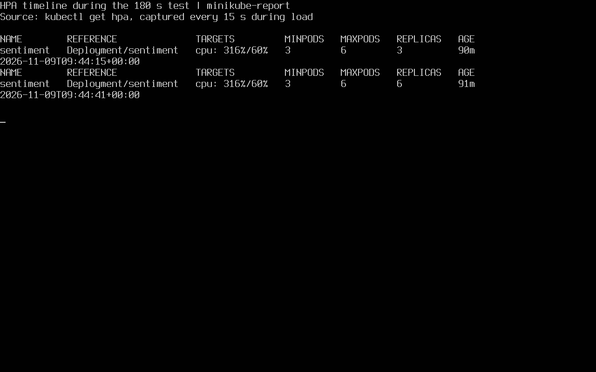

# Анализ тональности в Minikube

Java REST API определяет тональность русского и английского текста по словарю. Проект демонстрирует сборку компактного образа, развёртывание трёх реплик, маршрутизацию, балансировку и автомасштабирование в двухузловом Minikube. Стек включает Java 21, Spring Boot, Actuator, Docker, Kubernetes, Prometheus и Grafana.

## Структура

| Папка | Содержимое |
|---|---|
| [app/](app/) | Java-код, Maven, основной Dockerfile и сборка с готовым JAR |
| [k8s/](k8s/) | Namespace, Deployment, Service LoadBalancer, Ingress и HPA по CPU |
| [monitoring/](monitoring/) | Helm values, ServiceMonitor и JSON дашборда Grafana |
| [scripts/](scripts/) | Установка Minikube, запуск, сборка, развёртывание, мониторинг, тест нагрузки и очистка |
| [docs/](docs/) | Отчёт, презентация, схема, скриншоты и исходный вывод команд |

## Запуск на Linux

Понадобятся Docker, Minikube, kubectl, Helm, Bash, OpenSSL и Python 3. Java 21 и Maven на хосте нужны только для сборки с готовым JAR. Все команды ниже выполняются из корня проекта. Скрипты по умолчанию используют профиль `sentiment-lab`. Для другого профиля задайте `PROFILE` и используйте тот же контекст в командах проверки.

```bash
# Если Minikube ещё не установлен
bash scripts/install-minikube.sh
export PATH="$HOME/.local/bin:$PATH"

bash scripts/start-cluster.sh
bash scripts/build-image.sh
bash scripts/deploy.sh
bash scripts/install-monitoring.sh
```

Для двух узлов на ВМ использовалось 6 ГиБ памяти. Параметры `MINIKUBE_CPUS` и `MINIKUBE_MEMORY` настраивают ресурсы узлов. Сборка загружает образ `sentiment-app:1.0.0` на узлы и проверяет ограничение 150 МБ. Если зависимости Maven удобнее собрать заранее, выполните `mvn -B -f app/pom.xml package`, затем `bash scripts/build-image.sh --with-jar`.

## Проверка API и масштабирования

```bash
kubectl --context sentiment-lab -n sentiment get deploy,pods,svc,ingress,hpa -o wide
url="http://$(minikube -p sentiment-lab ip)"
curl -fsS -H 'Host: sentiment.local' "$url/api/sentiment?text=hello"
python3 scripts/load.py "$url" 180
```

`hello` → `{"sentiment":"positive"}`, `terrible` → `{"sentiment":"negative"}`, `table` → `{"sentiment":"neutral"}`. Для проверки через LoadBalancer запустите `minikube -p sentiment-lab tunnel` в отдельном терминале и используйте `EXTERNAL-IP` сервиса. Нагрузочный скрипт принимает URL входа, включая доступный NodePort. Заголовок `X-Served-By` показывает имя пода.

HPA использует Metrics Server. Цель — 60% от запроса 50m CPU, диапазон — 3–6 реплик. В зафиксированном тесте три пода обработали 3022 запроса, ещё 79 завершились ошибкой. HPA увеличил число реплик с 3 до 6.

## Мониторинг

```bash
kubectl --context sentiment-lab -n sentiment port-forward svc/sentiment-monitor-grafana 3000:80
```

Логин — `admin`. В отдельном терминале получите пароль командой:

```bash
kubectl --context sentiment-lab -n sentiment get secret sentiment-grafana-admin \
  -o jsonpath='{.data.admin-password}' | base64 -d
```

Откройте [Sentiment API в Grafana](http://localhost:3000/d/sentiment-lab-verified). Дашборд настроен на CPU, RPS, p95 и число реплик, чьи цели сбора имеют статус UP. ServiceMonitor запрашивает `/actuator/prometheus` каждые 15 секунд. Prometheus собирает метрики приложения через ServiceMonitor. Дашборд Grafana подтверждён с данными CPU, частоты запросов, задержки p95 и числа целей UP.

На учебной ВМ Grafana хранит временную базу в памяти и загружает из комплекта плагинов источник Prometheus. После пересоздания пода дашборд восстанавливается из JSON через ConfigMap.

## Материалы сдачи

- [Отчёт PDF](docs/report.pdf) и [презентация PowerPoint](docs/presentation.pptx)
- [Схема архитектуры](docs/architecture.png)
- [Два узла Ready](docs/screenshots/01-cluster.png), [размер образа](docs/screenshots/02-image.png), [проверка API](docs/screenshots/03-api.png), [развёртывание](docs/screenshots/04-workloads.png), [масштабирование](docs/screenshots/06-hpa.png)
- [Скрипт установки Minikube](docs/screenshots/10-install-script.png), [код REST-эндпоинта](docs/screenshots/11-endpoint-source.png), [Deployment](docs/screenshots/12-deployment-yaml.png), [Service и Ingress](docs/screenshots/13-routing-yaml.png), [HPA YAML](docs/screenshots/14-hpa-yaml.png)
- [Цели Prometheus](docs/screenshots/09-prometheus-targets.png), [дашборд Grafana](docs/screenshots/08-grafana.png), [поды мониторинга](docs/screenshots/15-monitoring-pods.png)
- [Все скриншоты](docs/screenshots/) и [вывод команд](docs/evidence/)



## Источники

[Remoe](https://arxiv.org/abs/2512.18674), [KIS-S](https://arxiv.org/abs/2507.07932), [AI Inference Scaling on HPC](https://arxiv.org/abs/2511.21413), [Cloud Native System](https://arxiv.org/abs/2507.18007), [Block](https://arxiv.org/abs/2508.03611).

## Очистка и Git

`bash scripts/cleanup.sh` удаляет ресурсы проекта из выбранного профиля. Namespace и сам профиль остаются доступны. Для восстановления локальной истории Git используйте `git clone sentiment-k8s-project.bundle sentiment-k8s-git` из папки с распакованным архивом.
